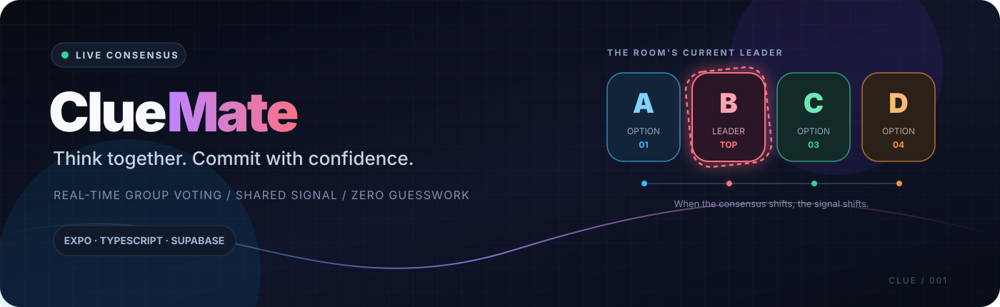
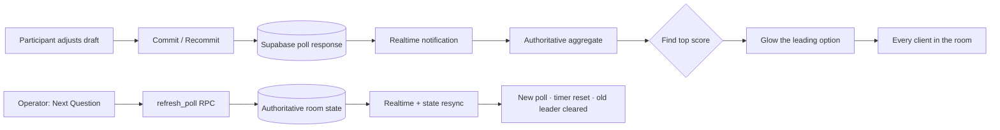

<div align="center">
  
  <br />
  <p><strong>A room full of opinions. One live signal.</strong></p>
  <p>ClueMate is a real-time group confidence-voting app for external vivas, quizzes, and decisions where the room needs to think together.</p>
  <p>
    
    
    
    
  </p>
  <p>
    <a href="#-what-makes-it-different">How it works</a> ·
    <a href="#-get-it-running">Get started</a> ·
    <a href="#-architecture">Architecture</a> ·
    <a href="#-verification">Verification</a>
  </p>
</div>

---

## `01` / The idea

Most group-voting tools collect answers. **ClueMate makes the room's changing confidence visible.**

Each participant distributes confidence across **A / B / C / D**, then explicitly commits their response. As committed votes arrive, the app calculates the active room's aggregate leader. The leading option gets a glowing, rotating dotted border—on **everyone's screen**, not just on the screen of someone who picked it.

> **The glow is the room's signal—not your personal selection.**

## `02` / What makes it different

<table>
  <tr>
    <td width="50%" valign="top">
      <h3>◉ Confidence, not just a click</h3>
      Split your confidence across four answers in 25% increments instead of being limited to a single pick.
    </td>
    <td width="50%" valign="top">
      <h3>◎ Commit means commit</h3>
      Draft changes stay local until the participant commits. Recommit replaces that participant's active response.
    </td>
  </tr>
  <tr>
    <td width="50%" valign="top">
      <h3>✳ One shared leader</h3>
      The leading answer is calculated from committed responses for the current poll version and reflected across clients.
    </td>
    <td width="50%" valign="top">
      <h3>⌁ Operator controls</h3>
      The room operator advances the poll and ends the session; participants follow the authoritative room state.
    </td>
  </tr>
  <tr>
    <td width="50%" valign="top">
      <h3>◌ Don't Know is a real response</h3>
      Participants can express uncertainty without pretending it is option A, B, C, or D.
    </td>
    <td width="50%" valign="top">
      <h3>◈ Built for the room</h3>
      A dark, mobile-first interface keeps attention on the question and the group's changing consensus.
    </td>
  </tr>
</table>

## `03` / The live-leader mechanic

The dotted border belongs around the **actual voting option card**. It is driven by the room's aggregate—not by the current user's selection, draft, or locally guessed result.

| Committed responses | Expected room-wide signal |
|---|---|
| No responses yet | No option is highlighted. |
| One participant commits `A = 100%` | `A` is highlighted on every client. |
| Two more participants commit `B = 100%` | `B` becomes the leader and the highlight moves to `B` everywhere. |
| Another answer overtakes the current leader | The highlight follows the new leader. |
| Two options tie for the highest positive score | Both leading options are highlighted. |
| A participant edits a draft but does not commit | The current leader does not change. |

**Option palette**

<table>
  <tr><td><code>A</code></td><td><code>#38BDF8</code></td><td><span style="color:#38BDF8">●</span> Sky</td><td><code>B</code></td><td><code>#FB7185</code></td><td><span style="color:#FB7185">●</span> Rose</td></tr>
  <tr><td><code>C</code></td><td><code>#34D399</code></td><td><span style="color:#34D399">●</span> Mint</td><td><code>D</code></td><td><code>#FB923C</code></td><td><span style="color:#FB923C">●</span> Orange</td></tr>
</table>

## `04` / Under the hood



The intended synchronization contract is straightforward:

- **Supabase is authoritative.** The operator's local screen must not independently decide that a poll has advanced.
- **Poll versions matter.** Responses and aggregate values from previous poll versions must not leak into the new question.
- **Realtime is a signal, not a substitute for state recovery.** Clients should load the latest server state on connection/reconnection and recover if an event is missed.
- **UI permissions are not security.** Room membership and operator-only actions must also be enforced by backend authorization and RLS.

## `05` / Stack

| Layer | Technology | Responsibility |
|---|---|---|
| App | React Native + Expo | Cross-platform mobile UI and development workflow |
| Language | TypeScript | Typed components, hooks, and app state |
| Navigation | Expo Router | Route and room navigation |
| State | Zustand | Shared client-side room/voting state |
| Backend | Supabase + PostgreSQL | Persistence, authentication, RPCs, and access policies |
| Realtime | Supabase Realtime | Room updates and committed-response change signals |
| Native persistence | Expo SecureStore | Native session storage adapter |
| Validation | TypeScript, `tsx`, Expo Doctor | Static checks and utility tests |

## `06` / Get it running

### Prerequisites

- Node.js and npm compatible with the Expo SDK installed in this repository
- A Supabase project
- Expo Go, a simulator, or another supported runtime

### Install

```bash
git clone <your-repository-url>
cd cluemate
npm install
```

### Configure Supabase

Create a `.env` file in the project root. If `.env.example` exists, use it as a template.

```env
EXPO_PUBLIC_SUPABASE_URL=https://YOUR_PROJECT_ID.supabase.co
EXPO_PUBLIC_SUPABASE_ANON_KEY=YOUR_PUBLIC_CLIENT_KEY
```

Copy the project URL and public client key from your Supabase project settings. Never place a `service_role` key in the app, in an `EXPO_PUBLIC_` variable, or in version control. Public client keys are not a replacement for correctly configured RLS policies.

### Database setup

The repository's initial migration is expected at:

```text
supabase/migrations/20261107000000_initial_schema.sql
```

Review the migration and the current database before applying it. If the schema is already present, **do not blindly rerun the migration**. Use the team's normal Supabase migration workflow or the SQL Editor after confirming what has already been applied.

### Start development

```bash
npx expo start -c
```

For a web development session, if supported by the installed project dependencies:

```bash
npx expo start --web
```

## `07` / Validation commands

Run from the repository root:

```bash
npx tsc --noEmit
npx --yes tsx src/utils/allocation.test.ts
npx --yes expo-doctor
npx expo export --platform web
```

These checks validate TypeScript, the allocation utility tests, Expo configuration, and the web export. **They do not prove multi-client Realtime behavior.**

## `08` / The real-world test checklist

Use at least three independently authenticated clients in the same test room when possible.

- [ ] Before anyone commits, no option is highlighted.
- [ ] One client commits `A = 100%`; every client sees `A` highlighted.
- [ ] Two more clients commit `B = 100%`; every client—including the first client—sees `B` highlighted.
- [ ] Recommitting replaces the previous response rather than double-counting the person.
- [ ] Draft changes do not alter the leader until committed.
- [ ] Advancing the poll updates every client and resets the timer.
- [ ] Previous-poll responses and the previous leader do not appear in the new poll.
- [ ] Reconnecting a client restores the current authoritative room state.
- [ ] Ending the room moves every client into a room-ended state.
- [ ] Ordinary participants cannot invoke operator-only actions.

Only mark a check as complete after observing it. A successful compile is not proof that two devices stayed synchronized.

## `09` / Project map

```text
src/
├── app/
│   ├── _layout.tsx
│   ├── index.tsx
│   └── room/
│       └── [id].tsx             # Room screen and operator controls
├── components/
│   ├── OptionCard.tsx           # Answer option UI
│   ├── VotingPanel.tsx          # Confidence allocation and commit controls
│   ├── LeaderboardOptionRow.tsx # Animated leader-border component
│   └── ResultsModal.tsx         # Legacy/separate results UI; remove if no longer used
├── hooks/
│   └── useRoomRealtime.ts       # Room subscription and synchronization
├── lib/
│   └── supabase.ts              # Supabase client
├── stores/
│   └── roomStore.ts             # Client room state
├── types/
│   ├── database.ts
│   └── voting.ts
└── utils/
    └── allocation.ts            # Confidence allocation rules

supabase/
└── migrations/
    └── 20261107000000_initial_schema.sql
```

This is a guide to the principal files discussed during development, not a guarantee that every path is still present. Confirm the current workspace before using it as an exhaustive tree.

## `10` / Troubleshooting

<details>
<summary><strong>Environment changes are not picked up</strong></summary>

Stop Expo and restart with a clean cache:

```bash
npx expo start -c
```
</details>

<details>
<summary><strong>One device advances, but the others stay on the old question</strong></summary>

Verify that all clients use the same Supabase project and room ID, that the operator's RPC succeeds, and that the room Realtime subscription is active. Confirm the server's poll version directly and test reconnection/resync behavior. Do not treat a local question-number change as proof of synchronization.
</details>

<details>
<summary><strong>The leader highlight does not move</strong></summary>

Check that the committed response was persisted, the aggregate refreshed, the active poll version matches, and the global leader state is passed to the actual A/B/C/D cards—not just to a separate results component.
</details>

<details>
<summary><strong>Supabase migration errors</strong></summary>

Check what tables, functions, policies, and Realtime publications already exist before applying SQL again. Avoid blindly rerunning an initial migration against a populated project.
</details>

## `11` / Security rules

- Keep service-role credentials out of client code, Git, and screenshots.
- Enforce room membership and operator permissions on the backend—not only by hiding buttons.
- Validate active poll versions when accepting responses.
- Preserve RLS and test it with ordinary participant accounts.
- Never commit real credentials to `.env`.

## `12` / Contributing

Before changing room state, votes, or synchronization:

1. Inspect the existing implementation and backend policies first.
2. Keep changes focused; preserve working modules and voting semantics.
3. Run the validation commands.
4. Test with independent clients when touching Realtime behavior.
5. Report automated results separately from manual checks that remain.

---

<div align="center">
  <h3>ClueMate</h3>
  <p><strong>Think together. See where the room stands.</strong></p>
  <sub>Built for the moment when everyone has an opinion—and the group needs a signal.</sub>
</div>
